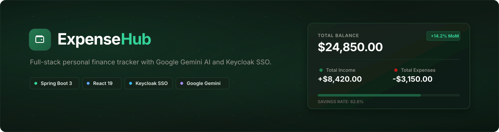

<div align="center">

  

  <br />
  <br />

  [](https://my-expensehub.netlify.app)
  [](https://react.dev/)
  [](https://spring.io/projects/spring-boot)
  [](https://www.keycloak.org/)
  [](https://www.postgresql.org/)
  [](https://ai.google.dev/)

  <p align="center">
    <b>Smart cash flow intelligence, automated goal pacing, and AI-driven financial advisory.</b>
  </p>

  <p align="center">
    <a href="https://my-expensehub.netlify.app"><strong>Explore Live Demo »</strong></a>
  </p>

</div>

---

## 🌟 Overview

ExpenseHub is an end-to-end personal finance management platform designed to help you monitor, budget, and optimize your money in one unified dashboard. Instead of relying on static spreadsheets, ExpenseHub provides interactive visual breakdowns of your cash flow, dynamic multi-horizon savings goals with velocity tracking, and an intelligent financial advisor powered by Google's Gemini API that delivers tailored advice based on your spending habits.

User authentication and federated Single Sign-On (Google and Microsoft) are managed through a dedicated Keycloak instance, ensuring secure session management and keeping user credentials isolated from the main application database.

---

## ✨ Key Features

* 📊 **Financial Dashboard:** Track income and expenses visually with interactive charts and a real-time balance breakdown.
* 🎯 **Goal Tracking:** Create savings goals and track your progress over time.
* 🤖 **AI Insights:** Uses the Google Gemini API to analyze your spending history and provide actionable tips to save money.
* 🔐 **Authentication:** OAuth2 / OpenID Connect login managed entirely by Keycloak, including options for SSO (Google/Microsoft).
* 📑 **Categorization:** Group transactions by category and export the data to Excel for your personal records.

---

## 🛠️ Tech Stack

### Frontend (Deployed on Netlify)
* **React 19, TypeScript, and Vite**
* **Tailwind CSS** for styling
* **Framer Motion and Recharts** for animations and data visualization

### Backend (Deployed on Railway)
* **Java 21 with Spring Boot 3**
* **Spring Security** (configured as an OAuth2 Resource Server)
* **Spring Data JPA & Hibernate**
* **PostgreSQL database**
* **Keycloak 24+** for Identity Management

### Integrations
* **Google Gemini AI API**

---

## 🔐 How Authentication Works

The app uses a standard OAuth2 flow:

```text
  [ User / Browser ]
          │
          │  1. Sign in (Credentials or SSO Google/Microsoft)
          ▼
   ┌──────────────┐
   │   Keycloak   │ ── User identity & credentials verified
   └──────────────┘
          │
          │  2. RSA-signed JSON Web Token (JWT) issued
          ▼
   ┌──────────────┐      3. Bearer Token Request      ┌─────────────────────┐
   │ React Client │ ────────────────────────────────► │ Spring Boot Backend │
   └──────────────┘                                   └─────────────────────┘
                                                                 │
                                                      Validates token signature
                                                      via Keycloak JWKS certs
                                                                 ▼
                                                      ┌─────────────────────┐
                                                      │ PostgreSQL Database │
                                                      └─────────────────────┘
```

1. **Keycloak:** All user accounts, passwords, and SSO integrations are stored in Keycloak, keeping credentials out of the main database.
2. **JWT Tokens:** When a user logs in, Keycloak generates an RSA-signed JSON Web Token (JWT).
3. **Validation:** The Spring Boot backend intercepts incoming API requests, fetches the public keys from Keycloak, and validates the token signature before allowing access to the protected routes.

---

## 🚀 Local Setup

To run this project on your own machine, you need **Java 21**, **Node.js 20+**, and **Docker**.

### 1. Start the Database & Keycloak
Use Docker to spin up local instances of PostgreSQL and Keycloak:
```bash
cd ExpenseHub
docker-compose up -d
```

### 2. Run the Spring Boot Server
Make sure your local `application.properties` points to your local database:
```bash
cd ExpenseHub
mvn spring-boot:run
```

### 3. Run the React Frontend
Open a new terminal:
```bash
cd frontend
npm install
npm run dev
```
Then go to `http://localhost:5173` in your browser.

---

## 👨‍💻 Author

**Madhav Mathur**  
* GitHub: [@MadhavMathur9](https://github.com/MadhavMathur9)
